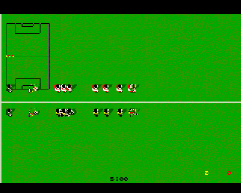
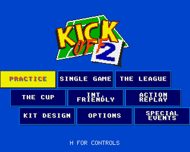
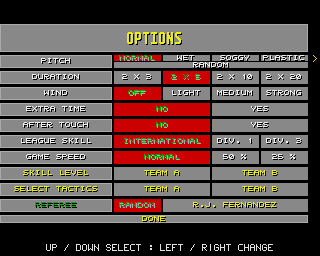
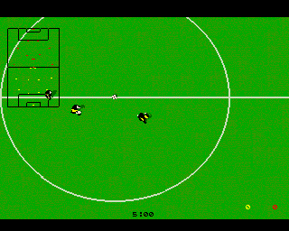
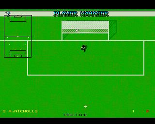
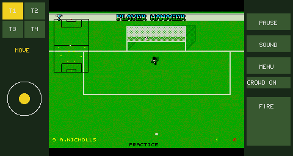

# Kick Off 2 Go

A native Go/Ebitengine remake of **Kick Off 2** for desktop and Android. It
opens directly on the game menu and includes Practice, Single Game,
International Friendly, League, Cup, Action Replay, Kit Design, four pitch
conditions, selectable referees, tactics, substitutions, cards, extra time and
penalty shootouts.



[Watch the full presentation video](media/kickoff2-demo.mp4)

## Desktop

Go 1.26 or newer and a desktop graphics environment are required.

```sh
go run .
```

Build and run a standalone executable:

```sh
make build
./bin/kickoff2
```

Useful launch options:

```sh
go run . -fullscreen             # Start in fullscreen mode.
go run . -practice               # Start Practice immediately.
go run . -demo                   # Start a CPU-versus-CPU match.
go run . -touch                  # Preview the Android touch layout.
go run . -mute                   # Disable audio.
go run . -scale 4                # Select an initial window scale from 1 to 8.
go run . -data-dir /path/to/data # Select the settings, saves and replay folder.
```

The game renders at the original 320 × 256 resolution and uses nearest-neighbor
scaling. Press **F11** at any time to toggle fullscreen mode. After 15 seconds
without input on the main menu or pause screen, a CPU-versus-CPU demonstration
starts automatically. Any input restores the previous screen, and subsequent
demonstrations rotate through different national teams.

## Controls

### Menus

| Input | Action |
| --- | --- |
| Arrow keys or WASD | Move the selection |
| Z, Enter or gamepad primary button | Confirm |
| Left/Right | Change the selected option |
| Escape | Go back or open the pause screen during a match |
| Mouse or touch | Select the item under the pointer |

### Players

| Player | Movement | Fire |
| --- | --- | --- |
| Player 1 / Team A | Arrow keys | Z or left Ctrl |
| Player 2 / Team B | I, J, K, L | O or right Ctrl |
| Cooperative player 3 | W, A, S, D | Q |
| Cooperative player 4 | U, B, N, comma | Y |

WASD also controls Team A when cooperative play is disabled. Standard gamepads
support the left stick or D-pad, the primary face button for Fire, the secondary
face button for player switching, Start for pause and the shoulder buttons for
tactic selection.

### Football actions

| Input | Action |
| --- | --- |
| Hold Fire before reaching the ball | Trap the ball |
| Hold a direction and release Fire | Pass |
| Press Fire just after touching the ball | Shoot |
| Reverse direction while dribbling | Chip the ball |
| Press Fire away from the ball | Slide or jump according to the ball height |
| Press a direction immediately after shooting | Apply aftertouch when enabled |
| Tab | Switch the controlled player |
| 1–4 | Select Team A tactic slot 1–4 |
| Numeric keypad 1–4 | Select Team B tactic slot 1–4 |
| F4 / F5 | Request Team A reserve 12 / 14 |
| F9 / F10 | Request Team B reserve 12 / 14 |
| Arrow keys, then Space or Enter | Select and confirm a substitution |
| R / S after a goal | Play the replay at normal / slow speed |
| F1 during replay | Save the replay |
| P or Space | Pause or resume |
| X | Toggle the scanner |
| H | Show the in-game controls |
| M | Toggle sound |
| C | Toggle crowd sound |
| F | Show the player view during a match |
| F11 | Toggle fullscreen mode |

At half-time and full-time, use Left/Right and Fire or Enter to continue or
leave. Squad selection starts on **DONE**: press Fire to continue, press Up to
enter the player list, use Left/Right to choose a shirt or controller, and press
Fire to apply the selection.

## Android

The Android build requires Go 1.26+, Java 17 or 21, Android SDK 36, Android
Build Tools 36.0.0 and Android NDK 28.2.13676358. Set `ANDROID_HOME` or
`ANDROID_SDK_ROOT` when the SDK is not installed in a standard location.

Build the ARM64 debug APK:

```sh
make android
```

Build, install and launch on one authorized USB device:

```sh
make android-run
```

The APK is written to:

```text
android/app/build/outputs/apk/debug/app-debug.apk
```

The landscape layout provides a movement stick, Fire, Pause, Sound, Menu,
Crowd and tactic controls. Substitution buttons replace Fire when a reserve is
requested. Returning from the background pauses the match and releases pending
touch input.

## Screenshots

| Main menu | Options |
| --- | --- |
|  |  |

| Match | Practice |
| --- | --- |
|  |  |

| Android touch controls |
| --- |
|  |

## Original game credits

The original in-game credits state **Program by Dino Dini**, **Graphics by
Steve Screech** and **© Anco Software Ltd**. Kick Off 2, its name, graphics,
audio and original game data remain the property of their respective copyright
holders. This independent fan remake is not affiliated with or endorsed by the
original rights holders.

No Amiga disk image is distributed in this repository. See [ADF.md](ADF.md) for
the reference version used by the project.
